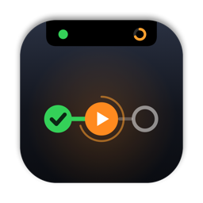
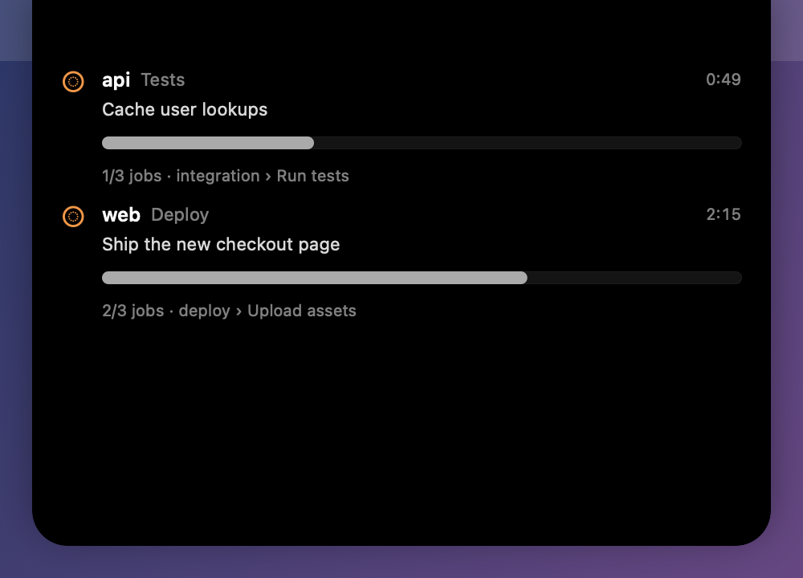
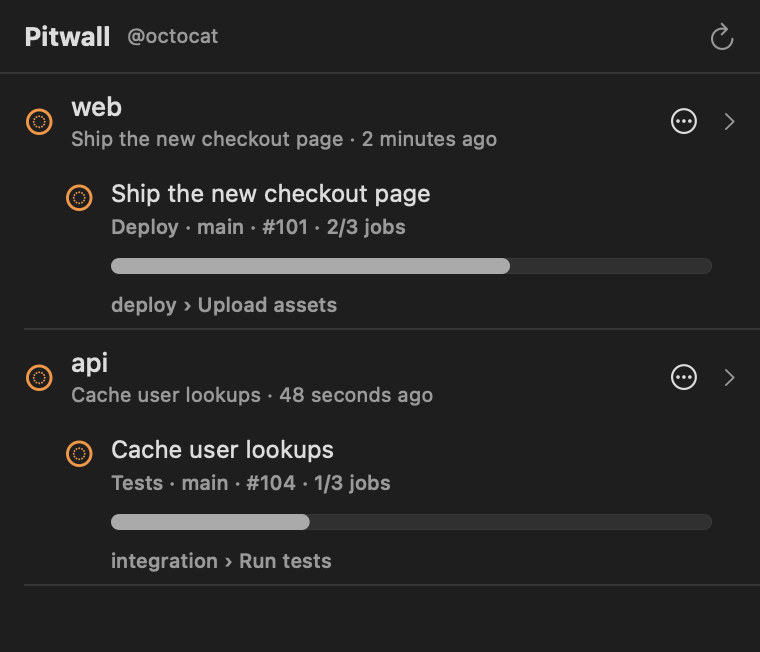

<p align="center">
  
</p>

<h1 align="center">Pitwall</h1>

<p align="center">GitHub Actions in your Mac's notch.</p>

Pitwall sits in the menu bar next to the clock. Pick the repositories you care about and it shows their latest workflow runs. When something is running, the notch grows two small wings: which repo, and how many jobs are done. Hover over it and you get the live list, with the current job and step for each run. When a run finishes you get a notification, and clicking it opens the run on GitHub.

<p align="center">
  
</p>
<p align="center">
  
</p>

You can also start workflows from the menu, re-run failed jobs, and cancel runs without opening a browser. Starting a workflow (`workflow_dispatch`) lets you search branches and tags, and shows the inputs declared in the workflow file as proper fields: text, number, toggles for booleans, a picker for choices, with their defaults.

<p align="center">
  
</p>

## Requirements

- macOS 14 or later (Apple silicon)
- Swift 6 toolchain (Xcode 16+)
- A GitHub token, or the GitHub CLI already logged in

Works on Macs without a notch too. You get a small pill at the top of the screen instead.

## Install

```bash
curl -fsSL https://raw.githubusercontent.com/TarasKovalenko/Pitwall/main/scripts/install.sh | bash
```

This downloads the latest release, checks its SHA-256, installs it into `/Applications` (or `~/Applications` if that isn't writable) and opens it. Run the same command again to update. Set `PITWALL_VERSION=v0.2.0` to install a specific version, or `PITWALL_DIR=...` to choose the folder.

Release builds are ad-hoc signed, not notarized, so the script clears the quarantine flag. If you download `Pitwall.zip` by hand from the Releases page, right-click the app and choose Open the first time.

## Releasing

Push a version tag. The `Release` workflow runs the tests, builds the app with that version stamped into `Info.plist`, and publishes `Pitwall.zip` and its checksum as a GitHub release. The version shows in the menu footer and in Settings → General. Local builds take it from the latest tag.

```bash
git tag v0.2.0 && git push origin v0.2.0
```

## Build and run

In Xcode, open `App/Pitwall.xcodeproj` (not `Package.swift`), pick the Pitwall scheme and press ⌘R. It builds a real `.app` bundle, which notifications need.

From the terminal:

```bash
scripts/build-app.sh          # builds build/Pitwall.app (ad-hoc signed)
open build/Pitwall.app
swift test                    # runs both test suites
swift test --enable-code-coverage   # same, with coverage
PITWALL_SCREENSHOTS=docs/screenshots swift test --filter Screenshots   # redraws the README screenshots
```

The screenshots are rendered from sample data (`Tests/PitwallAppTests/Screenshots.swift`), so they don't show any real repos.

Then open Settings from the menu bar icon:

1. **Account**: paste a token, or click "Use GitHub CLI login" if you have `gh` set up.
2. **Repositories**: search your repos and click Watch, or type `owner/repo`.
3. **General**: refresh rates, notch behaviour, which notifications you want, open at login.

### Token permissions

Fine-grained token: Actions (read and write), Contents (read), Metadata (read).
Classic token: `repo` and `workflow`.

Read-only access is enough if you only want to watch. Re-running, cancelling and dispatching need write access to Actions.

## How it handles your token

- Stored in `~/Library/Application Support/Pitwall/token`. The file is 0600 inside a 0700 folder, so only your user can read it, and it's written atomically. Pitwall ignores the file if it's a symlink, belongs to someone else, is readable by others or is oversized. The token never goes into UserDefaults or logs.
- Why not the Keychain? Releases are ad-hoc signed, and the Keychain only gives an item back to the exact build that saved it, so every update looked like a sign-out. Up to 0.2.1 the token lived in the Keychain. The first launch of a newer version moves it into the file (macOS may ask for your password once to allow that) and removes the Keychain copy.
- Only ever sent to `https://api.github.com`. The host is hard-coded, and redirects to any other host are refused, so a redirect can't leak the token.
- Repo names, branch names and input names are validated before they go anywhere near a URL or request body. Each path segment is encoded on its own, so `../` or `?` in a name can't change the request.
- The app only opens `https://github.com/...` links in your browser, including from notifications.
- "Use GitHub CLI login" runs `gh auth token` from a fixed path (`/opt/homebrew/bin` or `/usr/local/bin`) with fixed arguments and a stripped environment. No shell. It skips the binary if it's world-writable.
- Hardened runtime is on. The app isn't sandboxed yet because the `gh` import needs to run an outside binary. See the roadmap.

## Staying light

GitHub gives you 5,000 API calls an hour. Pitwall tries hard not to waste them, or your battery.

- Every GET sends the last `ETag`. Unchanged data comes back as a `304`, which GitHub doesn't count against your limit.
- It polls every 8 seconds while something is running and every 60 seconds when nothing is. Both are adjustable.
- When the remaining budget drops below 200 calls it spreads what's left over the rest of the hour. At zero it waits for the reset.
- Job details are fetched only for runs that are still going (six at most per cycle).
- At most four repos are fetched in parallel.
- Polling stops while the Mac sleeps and picks up right after wake.
- The notch panel and its mouse monitor only exist while there's something to show.

Measured on an M-series MacBook, signed out and idle: 0.0% CPU, about 18 MB memory, no idle wakeups.

## Project layout

```
App/Pitwall.xcodeproj  Xcode app target; compiles Sources/Pitwall, links PitwallCore
Sources/PitwallCore/   RunStore, API client, models, validation, polling, notification policy, token file (no UI)
Sources/Pitwall/       SwiftUI + AppKit app: menu bar, settings, notch panel, notifications
Tests/PitwallCoreTests/  Core: RunStore and GitHubClient through in-memory adapters, the YAML reader, policies, token storage
Tests/PitwallAppTests/   App: view logic, notch and app lifecycle, and every view rendered in its main states
Tests/Support/           Fakes shared by both: in-memory GitHub, scripted transport, sleepers
GLOSSARY.md              names used in the code (auth state, run action, poke, …)
scripts/build-app.sh     builds and signs the .app bundle
scripts/install.sh       installs the latest release (used by the curl one-liner)
.github/workflows/       CI on every PR and push to main; release on v* tags
docs/screenshots/        README images, rendered by the Screenshots test
scripts/make-icon.sh     redraws the app icon (scripts/make-icon.swift) into the asset catalog and .icns
```

## Roadmap

- GitHub OAuth device flow, so no token copy-paste
- App Sandbox, once the `gh` import moves to an XPC helper or goes away
- Per-repo filters: only my runs, only certain branches or workflows
- Job logs for failed steps, right in the expanded notch
- Global hotkey to expand the notch
- Developer ID signing and notarization, Sparkle updates
